<p align="center">
  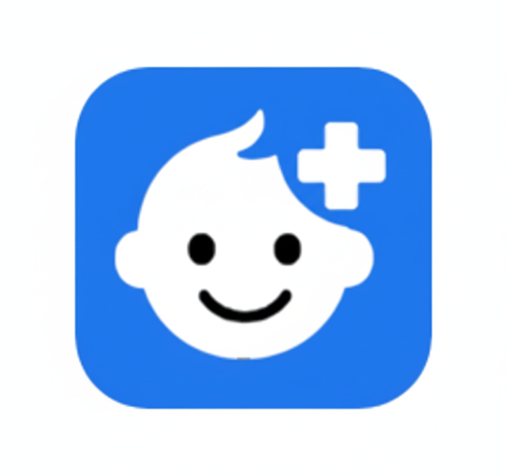
</p>

<h1 align="center">아이119 (child119)</h1>

> 소아 응급 상황에서 **"함정 없는 진짜 응급실"** 을 찾아주는 위치 기반 앱

LX 공간정보아카데미 최종 프로젝트 · 6인 팀 · 2025.10 ~ 2025.11
[프로젝트 정리 글 (Tistory)](https://caramelpopcorn.tistory.com/2)

<p align="center">
  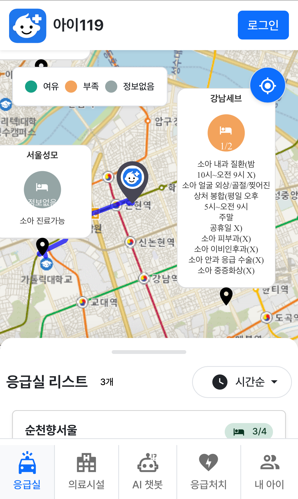
  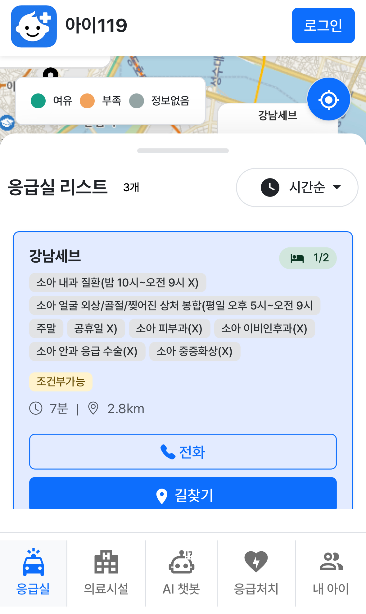
  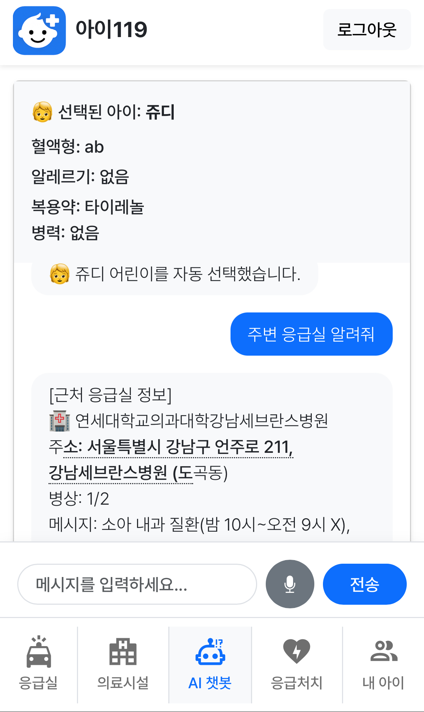
  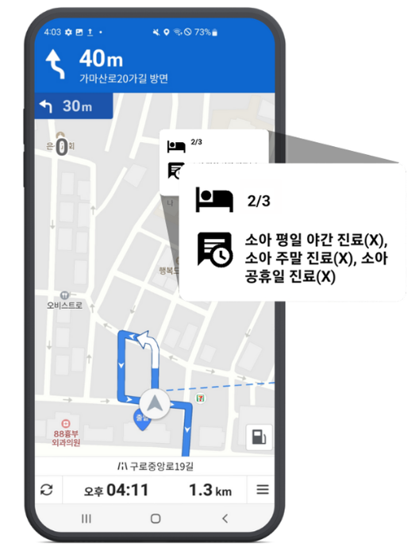
</p>

## 왜 만들었나

서울·경기 응급실의 소아 진료 거부는 2020년 154건에서 2024년 620건으로 **4배 이상** 늘었고, 소아 보호자가 구급차 대신 **자차로 이동하는 비율은 약 9배** 높습니다. 그런데 기존 서비스는 보호자가 응급실을 고르기에 부족했습니다.

| 기존 서비스의 한계 | 결과 |
|---|---|
| 지도는 "진료 중"만, 병상 현황은 "원활"만 보여주고 **응급실 공지 메시지가 따로** 있음 | 병상만 보고 가면 의료진 부재로 **진료 거부(함정)** |
| 공지 하나를 보려면 최소 **4번 화면 전환** | 급한 상황에서 확인 불가 |
| 공지가 "seizure 의료진 부재" 같은 **의학 용어** 위주 | 보호자가 이해하기 어려움 |
| 예상 소요 시간이 **직선 거리** 기준 | 실제 시간과 다름 |

보건복지부 앱 2종을 분석하고, 소방서 구급대원 서면·대면 인터뷰와 119 상황대응센터 인터뷰를 거쳐 요구사항(달빛어린이병원 안내, 응급실 직통번호, 아이 정보 사전 입력, 진료 가능한 응급실 즉시 파악)을 정리했습니다.

**아이119는 이렇게 해결합니다.**

- 응급실 **공지 메시지를 홈 화면에서 바로** 보여줍니다.
- 직선 거리가 아니라 **TMAP 네트워크 경로**로 실제 소요 시간을 보여줍니다.
- **진료 가능 상태·병상 수**로 먼저 거르고 가까운 순으로 보여줍니다.
- **내 아이 정보와 위치**를 반영하는 AI 챗봇이 증상에 맞는 응급실을 추천합니다.

## 주요 기능

<table>
  <tr>
    <td align="center" width="25%"><br><b>응급실 지도</b><br>병상 여유·부족·정보없음 색 구분, 진료 가능 항목, 경로선</td>
    <td align="center" width="25%"><br><b>응급실 목록</b><br>병상, 진료조건 태그, 소요 시간·거리, 전화·길찾기</td>
    <td align="center" width="25%">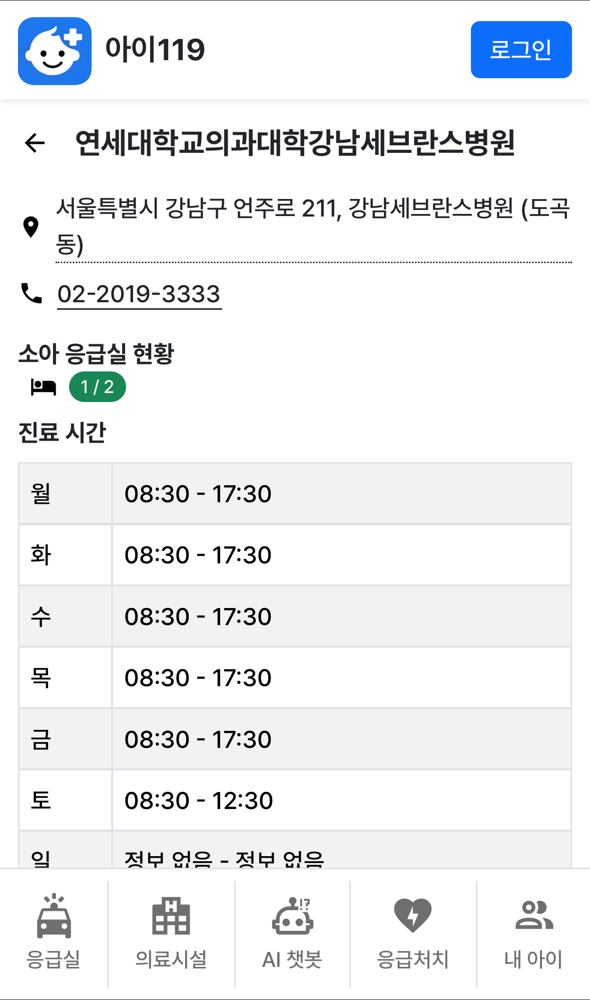<br><b>응급실 상세</b><br>주소, 직통 전화, 소아 응급실 현황, 요일별 진료시간</td>
    <td align="center" width="25%"><br><b>내비게이션</b><br>길안내 중에도 병상 수와 진료 불가 항목 표시</td>
  </tr>
  <tr>
    <td align="center">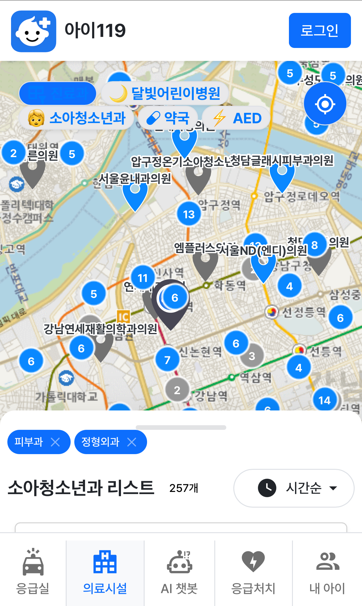<br><b>의료시설</b><br>소아청소년과 등 필터, 마커 클러스터</td>
    <td align="center">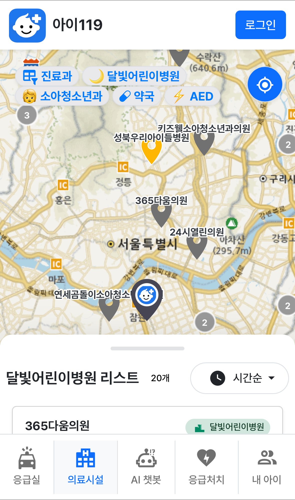<br><b>달빛어린이병원</b><br>야간·공휴일 경증 소아 진료 기관</td>
    <td align="center"><br><b>AI 챗봇</b><br>내 아이 프로필 + 위치 기반 추천, 음성 입력</td>
    <td align="center">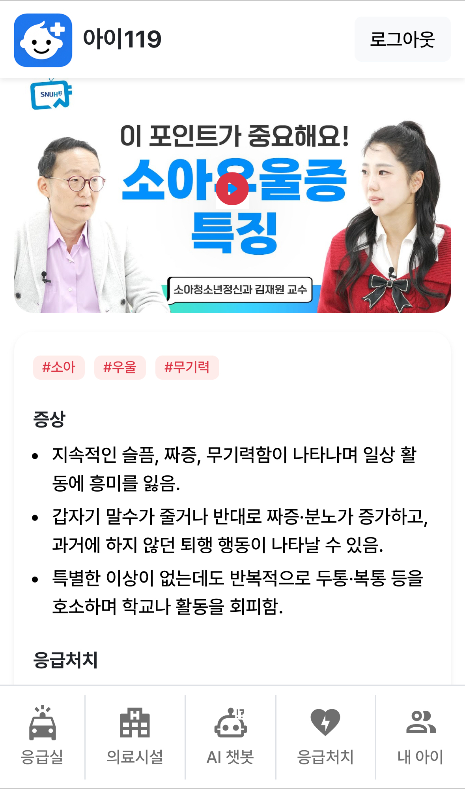<br><b>응급처치</b><br>증상별 응급처치 안내, 의사 팁</td>
  </tr>
  <tr>
    <td align="center" colspan="4">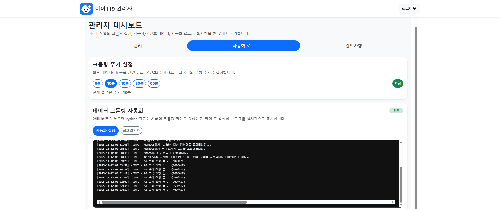<br><b>관리자 대시보드</b><br>크롤링 주기 설정(5~60분), Python 자동화 서버에 크롤링·AI 분석 작업 요청, 작업 로그 실시간 표시, 건의사항 관리</td>
  </tr>
</table>

그 밖에 내 아이 프로필 등록·수정, 사용자·콘텐츠 관리 기능이 있습니다.

## 아키텍처

<p align="center">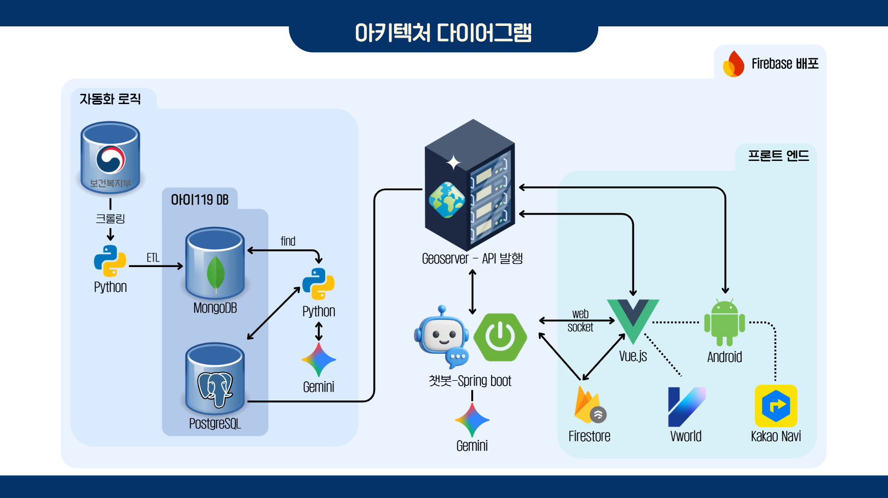</p>

| 영역 | 흐름 |
|---|---|
| **자동화 로직** | 보건복지부 데이터를 크롤링 → Python ETL → MongoDB(아이119 DB) 적재. Python이 MongoDB를 조회해 Gemini로 응급실 상태 메시지를 만들고 PostgreSQL을 갱신 |
| **GeoServer** | PostgreSQL(PostGIS)의 공간 데이터를 API로 발행. Vue 웹과 Android 앱이 이 API를 사용 |
| **챗봇** | Vue ↔ Spring Boot를 WebSocket으로 연결. Spring Boot가 Gemini를 호출하고 GeoServer 데이터를 참조 |
| **프론트엔드** | Vue.js(Firebase Hosting 배포), Firestore(사용자·아이 정보), VWorld(지도), Android(Kakao Navi) |

**챗봇 추천 흐름**

1. 클라이언트가 WebSocket으로 메시지와 위치를 보냄
2. 서버가 PostGIS에서 **하버사인 반경 5km** 내 응급실을 조회 (진료 가능 상태 1·2만, 거리순)
3. 병상 수와 증상으로 거른 뒤 상위 3곳 선택
4. 아이 정보 + 응급실 정보 + 시스템 프롬프트를 Gemini에 전달해 답변 생성

`emergency.state`: 0 = 진료 불가, 1 = 조건부 가능, 2 = 가능

## 기술 스택

| 영역 | 기술 |
|---|---|
| 백엔드 | Java 17, Spring Boot 3.5, Spring Data JPA, hibernate-spatial, WebSocket, Spring AI |
| 데이터 | PostgreSQL + PostGIS, MongoDB, Firebase Firestore, GeoServer |
| 자동화 | Python (크롤링·ETL, psycopg2), FastAPI, cron (병상 5분 주기 갱신), Puppeteer |
| 프론트엔드 | Vue 3, Vite 7, Pinia, Vue Router, Bootstrap |
| 지도·경로 | TMAP, VWorld, Kakao Navi SDK |
| 모바일 | Kotlin, WebView |
| AI | Gemini 2.0 Flash |
| 배포 | Docker, Cloud Run, Firebase Hosting |

## 저장소 구조

| 폴더 | 역할 |
|---|---|
| `springboot_child/` | 백엔드. 챗봇 WebSocket(`/ws/chat`), 응급실 근처 검색, 아이 정보 API |
| `vue_child/` | 사용자·관리자 웹 프론트엔드 |
| `kakao_navi/` | Android 앱 (WebView + 카카오내비 SDK) |
| `emergency_python/` | 데이터 수집·가공, DB 적재, 5분 주기 병상 갱신, 갱신 자동화 서비스 |
| `data/` | 달빛어린이병원·심야약국 CSV, 크롤러 |

## 데이터 출처

- 국립중앙의료원 응급실 병상 현황 (mediboard)
- 국립중앙의료원 아이케어톡 (소아 병원, 달빛어린이병원)
- e-gen 달빛어린이병원 정보
- 보건복지부·공공데이터포털 응급의료 정보
- VWorld 주소 지오코딩
-
병상은 5분마다, 병원 기본 정보는 수집 후 적재하는 방식으로 갱신합니다.

## 팀 구성

6인 팀 프로젝트입니다.

| GitHub | 역할 | 담당 |
|---|---|---|
| [caramelpopcornKHU](https://github.com/caramelpopcornKHU) | **팀장** | 프로젝트 총괄, GeoServer 구축, 파이썬 자동화 로직, 클라우드 인프라 구축, 안드로이드 내비 기능, 발표 |
| [eunho2](https://github.com/eunho2) | 부팀장 | AI 기반 챗봇 구현, Spring Boot WebSocket, 파이썬 크롤링, 자료조사 및 기획, 현장 인터뷰 |
| [suhyunnnnnni](https://github.com/suhyunnnnnni) | | UI/UX 총괄, TMAP API 연동, Git 프로젝트 관리, 자료조사 및 기획, 현장 인터뷰, 시연 |
| [younho-7878](https://github.com/younho-7878) | | TMAP API 연동, 응급실 페이지, 응급처치 페이지, 관리자 페이지, 현장 인터뷰 |
| [jsb3182](https://github.com/jsb3182) | | 로그인/회원가입, Firestore 구축, 내 아이 정보 페이지, 응급처치 페이지 |
| [HSMGeo](https://github.com/HSMGeo) | | DB 총괄, GeoServer 구축, 공공 API 추출, 의료시설 페이지, 현장 인터뷰, PPT 제작 |

## 실행 방법

> API 키와 DB 접속 정보는 저장소에 포함되어 있지 않습니다. 예시 파일을 복사해서 채워 주세요.

**백엔드**

```bash
cd springboot_child
cp src/main/resources/application.example.properties src/main/resources/application.properties
./mvnw spring-boot:run
# 또는
docker build -t child119 . && docker run -p 8080:8080 child119
```

주요 설정 키: `spring.datasource.url / username / password`, `gemini.api.key`, `gemini.api.url`, `firebase.config.path`, `search.radius.km`(기본 5)

**프론트엔드**

```bash
cd vue_child
cp .env.example .env
npm install
npm run dev     # 개발 서버
npm run build   # 배포 빌드
```

**데이터 갱신**

`emergency_python/automation/update_bed.py` (환경변수 `DB_HOST`, `DB_NAME`, `DB_USER`, `DB_PASS`)

## 한계와 앞으로

- 챗봇은 프롬프트 엔지니어링 기반입니다. 상용화한다면 의료 정보로 **파인튜닝**해 아이 중증도에 따른 응급실·병원 기준을 제시할 계획입니다.
- 자차로 방문한 경우의 진료 거부는 통계가 비어 있습니다. 아이119로 모이는 **사용자 경로 로그를 관할 기관에 제공**해 소아 응급 의료 개선에 기여하는 방안을 구상했습니다.
